# Truth Arbitrage

> **A decentralized narrative intelligence terminal that finds truth gaps across languages.**
>
> 价格有价差，真相也有。

**Live demo:** [https://truth-arbitrage-680405849591.asia-east1.run.app](https://truth-arbitrage-680405849591.asia-east1.run.app)

**GitHub:** [https://github.com/Fu99966/truth-arbitrage](https://github.com/Fu99966/truth-arbitrage)

Truth Arbitrage projects one public claim into multiple language ecosystems, gathers current evidence, asks two different models on Gonka to investigate and challenge one another, and compiles the result into an auditable Truth Score. Its signature metric, **Narrative Spread**, exposes the largest gap between how often a story is repeated and how well it is supported.

## Why it can win

- **Memorable product metaphor:** language ecosystems behave like markets; narrative repetition is sentiment; evidence is fundamentals.
- **Gonka is essential:** claim extraction, evidence evaluation, and adversarial review all run through GonkaRouter, with every real response ID shown in the audit ledger.
- **Public value:** the flagship flow stops a multilingual disaster-aid scam before vulnerable users pay or forward it.
- **Transparent by design:** the score uses published deterministic weights and exposes uncertainty, counter-evidence, source independence, and model disagreement.
- **Demo-safe:** three one-click cases work without credentials, but simulated receipts are visibly separated from live Gonka receipts.

## Product flow

```mermaid
flowchart LR
    A["Text, URL, or image"] --> B["Kimi claim desk on Gonka"]
    B --> C["Multilingual queries"]
    C --> D["Google News + Wikimedia evidence"]
    D --> E["Kimi evidence investigator"]
    E --> F["MiniMax adversarial skeptic"]
    F --> G["Transparent score compiler"]
    G --> H["Truth Score + Narrative Spread"]
    H --> I["Gonka Request ID ledger"]
```



## Quick start

Requirements: Node.js 20+ and npm.

```bash
npm install
npm run dev
```

Open [http://localhost:5174](http://localhost:5174). The Express API runs on port `8788`.

For a production build:

```bash
npm test
npm run build
npm start
```

Then open [http://localhost:8788](http://localhost:8788).

The included `Dockerfile` builds the React client and serves it together with
the Express API from one container. It listens on the platform-provided `PORT`,
so the same image can run on Cloud Run without a frontend/backend URL split.

## Enable live Gonka inference

Copy `.env.example` to `.env` and set your hackathon key:

```dotenv
GONKA_API_KEY=sk-your-hackathon-key
GONKA_BASE_URL=https://api.gonkarouter.io/v1
GONKA_INVESTIGATOR_MODEL=moonshotai/Kimi-K2.6
GONKA_SKEPTIC_MODEL=MiniMaxAI/MiniMax-M2.7
GONKA_ATTEMPT_TIMEOUT_MS=30000
GONKA_RETRY_DELAY_MS=750
GONKA_MODEL_COOLDOWN_MS=300000
ENABLE_LIVE_SEARCH=true
ENABLE_GDELT=false
```

Restart the server. The top-right status becomes **LIVE ON GONKA**. Custom text, URL, and image submissions will then run the model committee. Transient timeouts, `429`, `5xx`, and Router `unsupported model` responses trigger bounded fallback. A model rejected by the inference endpoint enters a five-minute local cooldown even if `/models` still lists it. The audit ledger labels fallback calls and reports a degraded single-model result instead of pretending cross-model consensus. API keys never enter the browser.

Safe connectivity checks:

```bash
npm run smoke:gonka
npm run smoke:search
npm run smoke:live
```

## Demo cases

| Case | Purpose | Expected outcome |
|---|---|---|
| 50 USDT relief verification fee | High-harm multilingual aid scam | `9 / 100 · FALSE / HARMFUL` |
| EV lifecycle emissions | A true research topic distorted by absolute language | `34 / 100 · MISLEADING` |
| Free emergency water point | Positive control proving the product does not reject everything | `86 / 100 · VERIFIED` |

## Truth Score

The score is not generated by a final “judge model.” It is compiled from fixed weights:

- Kimi investigator support probability: **36%**
- MiniMax skeptic support probability: **36%**
- Reliability-weighted evidence direction: **18%**
- Independent source provenance: **10%**

Model disagreement, missing sources, and weak reliability increase uncertainty. Narrative Spread never directly increases truth; popularity is not evidence.

## API

| Method | Endpoint | Purpose |
|---|---|---|
| `GET` | `/api/health` | Gonka mode and selected models |
| `GET` | `/api/demo` | Three labelled demo cases and featured analysis |
| `POST` | `/api/analyze` | Run a demo case or live multilingual verification |

Live request example:

```json
{
  "inputType": "text",
  "text": "A public claim to verify"
}
```

Image requests add a `data:image/png;base64,...` value in `imageDataUrl`. URL mode performs a guarded server-side fetch and rejects private-network destinations.

## Repository map

```text
src/App.jsx                 Narrative terminal and full demo flow
src/styles.css              Editorial trading-desk visual system
server/analysisEngine.js    Gonka model committee orchestration
server/gonkaAdapter.js      Router calls, JSON parsing, real receipts
server/evidenceSearch.js    Open evidence search and guarded URL extraction
server/scoring.js           Published deterministic score compiler
server/demoData.js          Labelled, non-deceptive demo scenarios
docs/TECHNICAL.md           Architecture and sponsor integration
docs/DEMO_SCRIPT.md         2.5-minute video script and recording checklist
docs/SUBMISSION_PACKAGE.md  Copy-ready hackathon submission package
```

## Evidence semantics

| Label | Meaning |
|---|---|
| Live Gonka receipt | Actual response/request ID returned by GonkaRouter |
| Open evidence | Current Google News RSS and Wikimedia source discovered by the retrieval adapter; optional GDELT is disabled by default |
| Demo receipt | A UI simulation labelled `simulated-not-network-proof`; never represented as Gonka proof |

Truth Arbitrage is a decision-support and media-literacy tool, not a guarantee of truth. Medical, legal, emergency, and financial decisions should be checked against primary authorities.

## Documentation

- [Complete submission package](docs/SUBMISSION_PACKAGE.md)
- [Cloud deployment runbook](docs/DEPLOYMENT.md)
- [Technical design](docs/TECHNICAL.md)
- [2.5-minute demo video script](docs/DEMO_SCRIPT.md)
- [Hackathon submission copy](docs/HACKATHON_SUBMISSION.md)
- [Product design decision](docs/plans/2026-07-15-truth-arbitrage-design.md)

[MIT License](LICENSE)
