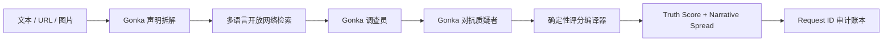

# Truth Arbitrage｜黑客松提交包

> 本文是提交材料的唯一入口。方括号中的 3 个链接在发布后替换，其余文案可直接复制到报名表。

## 交付链接

| 交付物 | 提交内容 |
|---|---|
| 可运行 Demo | [https://truth-arbitrage-680405849591.asia-east1.run.app](https://truth-arbitrage-680405849591.asia-east1.run.app) |
| GitHub 仓库 | [https://github.com/Fu99966/truth-arbitrage](https://github.com/Fu99966/truth-arbitrage) |
| 产品演示视频 | `[待上传后填写 YouTube / Bilibili / Loom URL]` |
| 技术说明 | [`TECHNICAL.md`](TECHNICAL.md) |

## 可直接复制的报名文案

### 项目名称

**Truth Arbitrage — 跨语言真相套利引擎**

### 参赛赛道

**赛道三：Gonka — AI for Society**

### 项目形态

**Web App / Decentralized AI Agent**

### 一句话介绍

Truth Arbitrage 利用 Gonka 上可审计的多模型委员会，寻找同一公共声明在不同语言世界中的“叙事价差”，将社交重复与真实证据分离。

**English:** Truth Arbitrage finds the narrative spread of a public claim across languages, then uses an auditable model committee on Gonka to separate social repetition from evidence.

### 项目简介（约 150 字）

虚假信息并不会在所有语言中均匀传播：一条消息可能在中文群聊里被大量转发，却得不到英文官方信源支持。Truth Arbitrage 支持输入文本、链接与图片，自动拆解原子声明，生成多语言检索词并获取开放网络证据，再通过 Gonka Router 上的调查员与对抗质疑者完成核验。产品输出 0–100 Truth Score、不确定性、跨语言 Narrative Spread、安全行动建议，以及逐步对应的 Gonka Request ID，让弱势语言用户看到的不只是结论，还有可追溯的证据链。

### 要解决的问题

非英语用户、移民、老年人和灾害受影响人群，经常收到“证据最弱、语气最急”的信息。传统事实核查往往只给出真假结论，却无法回答三个关键问题：这条叙事在哪些语言圈被放大？看似不同的来源是否都在循环引用同一张截图？AI 的判断经过了哪一个模型、哪一步推理，能否被审计？

### 解决方案

Truth Arbitrage 把事实核查重构为一场“真相套利”：

1. 从文本、公开链接或图片中提取可独立核验的原子声明。
2. 自动生成跨语言查询，从 Google News RSS 与 Wikimedia 开放知识中收集当前证据。
3. 通过 `gonkarouter.io` 调用不同角色的模型：调查员解释证据，质疑者寻找时间冲突、循环引用、翻译偏差和缺失的一手来源。
4. 用公开的确定性权重编译 Truth Score，而不是再让一个“裁判模型”拍脑袋。
5. 输出跨语言 Narrative Spread、安全行动建议、证据列表和 Gonka Request ID 审计账本。

### 为什么必须使用 Gonka

一个面向公共真相的产品，不应依赖单一、不可见的模型提供商。Gonka 让不同模型能够通过同一去中心化推理入口承担不同角色；Router 返回的真实 Request ID、模型名、延迟、Token 用量和回退状态，又构成了产品的信任层。Gonka 在这里不是隐藏的后端依赖，而是用户界面中可以检查的公共推理基础设施。

### 公共价值

旗舰案例用于阻止针对灾民的“先支付 50 USDT 验证费才能领取救助”骗局。相同引擎还能核查公共卫生谣言、极端天气通知、慈善募捐、移民招聘骗局和气候信息，并通过多语言检索降低非英语地区的信息获取门槛。

### 技术创新

- **Narrative Spread：**衡量同一声明在不同语言信息圈中的支持度差异，但不把传播热度当作真相。
- **对抗式模型委员会：**调查员负责形成证据报告，质疑者专门尝试推翻它，降低单模型偏差。
- **确定性评分编译器：**模型支持度、证据可靠性与独立来源按公开权重合成 0–100 分。
- **可追溯推理账本：**每个推理步骤显示 Gonka Request ID、实际模型、延迟、Token 与输入摘要。
- **诚实降级：**模型不可用、限流或超时时自动有限重试与回退，并明确标记单模型降级，不伪造跨模型共识。

## 核心架构

技术栈：React 19、Vite、Node.js、Express、Gonka Router、Google News RSS、Wikimedia Open Knowledge、Vitest。

## 核心功能

| 功能 | 评委能看到什么 |
|---|---|
| 多模态信息输入 | 文本、公开链接、图片素材入口 |
| 原子声明拆解 | 将复合消息拆成可独立核验的小声明 |
| 跨语言实时检索 | 不同语言、立场、时间与域名的证据列表 |
| Gonka 去中心化核验 | 调查、质疑、回退与降级均经 Router 完成并记录 |
| Truth Score | 0–100 标准化分数、结论和不确定性 |
| Narrative Spread | 语言生态之间的最大支持度差值 |
| 安全行动建议 | 对诈骗、公共安全等高风险声明给出非武断的下一步 |
| 审计账本 | 每一步真实 Gonka Request ID 与模型元数据 |

## 可复现的 Gonka 接入证据

一次本地 live run 已通过 Gonka Router 完成并返回以下真实 Request ID：

- `req-1784214858491480980-151493`
- `req-1784214874826826670-151717`
- `req-1784214875351167981-151727`

公开 Cloud Run Demo 的端到端 live run 还返回了以下真实 Request ID：

- `req-1784218842596124794-196819`
- `req-1784218852220740048-196950`
- `req-1784218870327895500-196963`

这些 ID 只用于证明 Router 调用链路；最终视频应以录制当时界面显示的新 Request ID 为准。预置演示案例的模拟 ID 会明确标记为 `simulated-not-network-proof`，不会冒充网络凭证。

## 路线图

### 0–1 个月：从 Demo 到可用产品

- 上线公开部署、用户限流、会话与历史核验记录。
- 接入更多一手公共数据源，补充来源独立性与声誉数据。
- 完成中文、英语与东南亚主要语言的无障碍测试。

### 1–3 个月：社区事实核查网络

- 允许记者、NGO 与研究者提交证据或挑战现有结论。
- 为已验证结果生成可嵌入社交平台的公开核验卡片。
- 将证据链与推理凭证持久化，提供可验证的结果快照。

### 3–6 个月：公共 AI 基础设施

- 建立开放的来源治理与评分政策，避免单一机构控制。
- 提供 Bot、浏览器扩展和公共 API，覆盖群聊与社区场景。
- 利用 Gonka 免费 Token 额度运行公益核验队列和多语言模型评测。

## 评委演示路径

1. 打开首页，用 10 秒解释“价格有价差，真相也有”。
2. 展示 50 USDT 灾害救助骗局，运行真相套利。
3. 指出 Truth Score、Narrative Spread 与独立来源数量。
4. 展开一个证据条目，说明传播热度不是证据。
5. 展示安全行动建议与公开评分权重。
6. 滚动到 Gonka 审计账本，展示真实 Request ID 和实际模型。

完整旁白与镜头安排见 [`DEMO_SCRIPT.md`](DEMO_SCRIPT.md)。

## 提交前清单

- [x] Web App 可在本地运行
- [x] README 包含功能、安装、运行与 Sponsor 接入方式
- [x] 技术说明包含赛道、Gonka、架构、关键功能与路线图
- [x] 2–3 分钟演示脚本与录制清单
- [x] API Key 只保存在服务器 `.env`，不会提交到 GitHub 或出现在视频中
- [x] 创建 GitHub 仓库并填写链接
- [x] 部署公开 Demo 并填写链接
- [ ] 录制、剪辑、上传视频并填写链接
- [ ] 录制前运行 `npm test`、`npm run build`、`npm run smoke:gonka`

## 透明性说明

产品设计支持 Kimi 与 MiniMax 的双模型交叉核验。当前黑客松 Key 的 `/models` 可能列出 Kimi，但 `/chat/completions` 实际只授权 MiniMax；系统会自动回退并把结果标记为 `degraded-single-model`。提交时可以展示这一容错能力，但只有在第二个模型真实返回 Gonka Request ID 后，才应宣称该次结果完成了跨模型共识。
